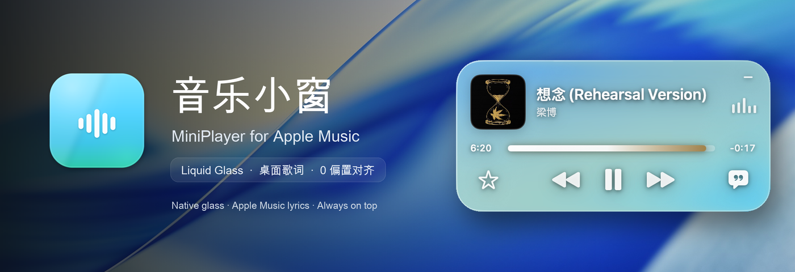
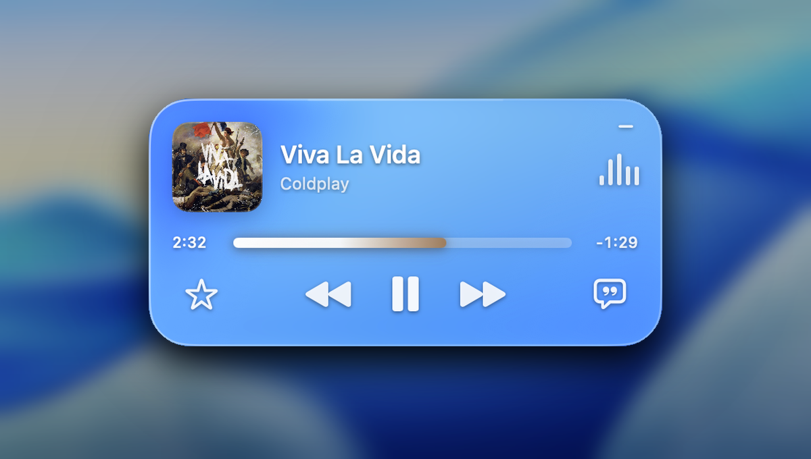
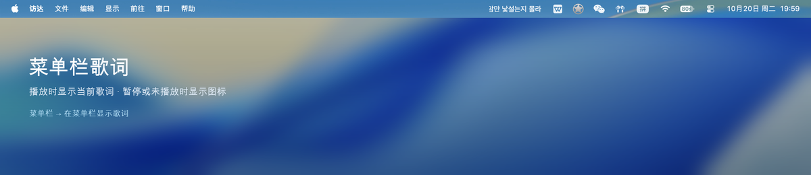
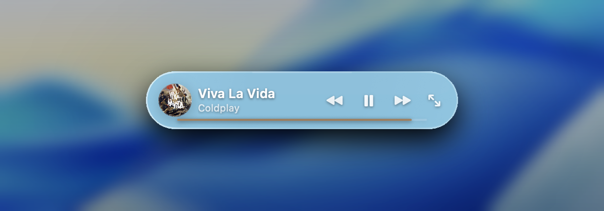

<div align="center">



# MiniPlayer for Apple Music

**A floating Apple Music player for macOS, with just the right amount of desktop and menu bar lyrics.**

English | [简体中文](README.md)

<p>
  <a href="https://github.com/Kensh1n-Ch3n/MiniPlayer/releases/latest"></a>
  
  
  
  <a href="LICENSE"></a>
  <a href="https://github.com/Kensh1n-Ch3n/MiniPlayer"></a>
  <a href="#-support-the-author"></a>
</p>

<p>
  <a href="#-features">Features</a> ·
  <a href="#-screenshots">Screenshots</a> ·
  <a href="#-installation">Installation</a> ·
  <a href="#-usage">Usage</a> ·
  <a href="#-lyrics-and-sync">Lyrics &amp; Sync</a> ·
  <a href="#-resource-usage">Resource Usage</a> ·
  <a href="#-faq">FAQ</a> ·
  <a href="#-license">License</a> ·
  <a href="#-support-the-author">Support</a>
</p>

</div>

---

## ✨ Features

- **Native Liquid Glass**: macOS 26+ uses SwiftUI's `.glassEffect(.clear, in:)` for system refraction, blur, and edge highlights; macOS 14–15 falls back to a custom blur.
- **Mini capsule mode**: collapse the player into a 300×56 capsule with artwork, title, previous / play-pause / next, expand, and a thin progress line. Click the artwork to open Apple Music; hovering shows a highlight and an open arrow.
- **Full playback controls**: favorite, previous, play / pause, next; the progress bar supports click and drag seeking.
- **Native interaction feedback**: play/pause icons scale-swap, previous/next slide out in their direction and slide back in; rapid clicks are serialized so state never flips incorrectly.
- **Artwork opens Apple Music**: clicking the artwork opens or activates Music and hides the widget. The music window and widget are mutually exclusive; closing, minimizing, or quitting Music brings the widget back automatically.
- **Single-line desktop lyrics**: only the current line is shown — no previous or next line. The window width adapts to lyric length, so short lines are narrower and long lines wider, leaving more room to drag horizontally. Toggle with the lyrics button at the lower-right of the player.
- **Menu bar lyrics**: the current line appears in the menu bar. Long lines scroll horizontally and smoothly, stop after the full line has been shown, and do not loop. Line changes slide vertically. Hold `⌘` and drag the item to reposition it in the menu bar.
- **Drag lyrics directly**: hover the desktop lyric text to get a hand cursor, then drag the text itself; the position is saved automatically. No menu or extra handle is needed.
- **Lyric sync**: prefers Apple Music's local cached line-synced TTML and uses Apple's own timeline with zero offset by default.
- **Lyric fallbacks**: if no official cache exists, tries LRCLIB synced LRC, then NetEase Cloud Music LRC, and finally embedded lyrics / estimated timing.
- **Original language first**: Traditional Chinese is converted to Simplified Chinese; English, Korean, and Japanese stay in their original language and are no longer replaced by Chinese translations.
- **On-screen bounds**: both the player card and desktop lyrics are constrained to the visible screen area and cannot be dragged off-screen.
- **Low overhead**: with desktop lyrics visible during playback, about **1.1% CPU** and roughly **40 MB** resident memory.

## 📸 Screenshots

<p align="center">
  <b>Full Liquid Glass player</b><br><br>
  
</p>

<p align="center">
  <b>Single-line desktop lyrics</b><br><br>
  
</p>

<p align="center">
  <b>Menu bar lyrics</b><br><br>
  
</p>

<p align="center">
  <b>Mini capsule mode</b><br><br>
  
</p>

> Native glass samples the windows behind it in real time. A photo or wallpaper behind it produces blurred colors; a white window behind it makes it look white. This is how system glass behaves.

## 🚀 Installation

### Download

1. Download and unzip [MiniPlayer.zip](https://github.com/Kensh1n-Ch3n/MiniPlayer/releases/latest/download/MiniPlayer.zip).
2. Drag `MiniPlayer.app` into your Applications folder.
3. Double-click to open it.

On first launch, macOS will ask:

> "MiniPlayer.app" wants to control "Music.app"

Choose **Allow**. If you accidentally choose "Don't Allow", open **Automation Permission Settings…** from the MiniPlayer menu bar menu, or go to:

`System Settings → Privacy & Security → Automation → MiniPlayer → Music`

### Requirements

- macOS 14 or later
- Apple Music
- Native Liquid Glass requires macOS 26+; older systems automatically use the fallback glass effect

## 🎮 Usage

| Action | How |
| --- | --- |
| Move the player | Drag the empty top area of the card |
| Open Apple Music | Click the album artwork; the widget hides and returns when the Music window closes |
| Show / hide the player | Menu bar music icon, `⌘⇧M` |
| Collapse to mini mode | Collapse button at the top-right of the card, or menu bar → Collapse to Mini Mode |
| Expand the full player | Expand button at the right of the capsule, or menu bar → Expand Full Player |
| Show / hide desktop lyrics | Lyrics button at the lower-right of the card, `⌘⇧L` |
| Show / hide menu bar lyrics | Menu bar menu → Show Lyrics in Menu Bar |
| Reposition menu bar lyrics | Hold `⌘` and drag the menu bar lyric item |
| Move desktop lyrics | Drag the lyric text directly |
| Adjust lyric timing | Menu bar → Lyrics Settings → 0.2s earlier / later |
| Adjust lyric size / position | Menu bar → Lyrics Settings |
| Support the author | Menu bar → Buy Me a Coffee… |
| Quit | Menu bar → Quit MiniPlayer, `⌘Q` |

## 🎵 Lyrics and Sync

### Source priority

1. **Apple Music official TTML cache**: when Music plays a track, it caches official line-synced lyrics locally. MiniPlayer parses Apple's own timeline. This is the default zero-offset source.
2. **LRCLIB**: if Apple has no cache, use LRCLIB synced LRC.
3. **NetEase Cloud Music LRC**: used when LRCLIB only has plain text.
4. **Embedded Apple Music lyrics / estimated timing**: final fallback; alignment is not guaranteed without a real timeline.

Lyrics cache directory: `~/Library/Caches/MiniPlayer/lyrics`

### About offsets

- Tracks with a real timeline are **aligned at offset 0**.
- If a particular release has its own timing offset, adjust it in ±0.2s steps from the menu bar.
- English, Korean, and Japanese lyrics keep their original text; Chinese translations are no longer substituted.

## ⚡ Resource Usage

Measured locally with `top` on Apple Silicon / macOS 27:

| State | Average CPU |
| --- | ---: |
| Playing + desktop lyrics visible | **1.14%** |
| Playing + desktop lyrics hidden | **0.75%** |
| Paused | **0.64%** |

- Resident memory: about **40 MB**
- Lyrics are not redrawn at 10 Hz; the app wakes precisely at the next line timestamp
- The equalizer runs on Core Animation and does not continuously occupy the main thread

## 🛠️ Build from Source

Requires Xcode 15+ and Swift 5.9+.

```bash
cd MiniPlayer
./scripts/build.sh
```

Build outputs:

- `dist/MiniPlayer.app`
- `dist/MiniPlayer.zip`

The app prefers an available local Apple Development certificate; without one it falls back to ad-hoc signing. It only uses system frameworks and has no third-party runtime dependencies.

## ❓ FAQ

<details>
<summary><b>Why does the widget disappear after I click the album artwork?</b></summary>

This is intentional: the main Apple Music window and the widget are mutually exclusive on screen. Closing, minimizing, or quitting Music brings the widget back automatically.
</details>

<details>
<summary><b>Why are lyrics sometimes estimated?</b></summary>

Apple Music's scripting interface does not expose line timings. If there is no official TTML cache locally and neither LRCLIB nor NetEase has synced LRC, MiniPlayer can only estimate from plain text, and perfect zero-offset alignment is not guaranteed.
</details>

<details>
<summary><b>Why isn't it on the App Store?</b></summary>

This is a local utility without notarization or sandbox adaptation. Public distribution would require additional signing and review configuration.
</details>

## ☕ Support the Author

If MiniPlayer is useful to you, consider buying me a cup of tea. Your support keeps it going.

<p align="center">
  
</p>

<p align="center">
  <b>Open Alipay and scan the QR code</b><br>
  <sub>Buy Me a Coffee · 饮茶先啦 (*晨)</sub>
</p>

## 🙏 Credits

- [Apple SwiftUI `Glass` documentation](https://developer.apple.com/documentation/SwiftUI/Glass) and [awesome-liquid-glass](https://github.com/GetStream/awesome-liquid-glass): references for native Liquid Glass
- [LRCLIB](https://lrclib.net): open synced lyric data

## 📄 License

This project is released under the **MIT License**. See [LICENSE](LICENSE) for the full text.

---

<div align="center">
  <sub>Made for macOS · Apple Music only · Released under the MIT License</sub>
</div>
