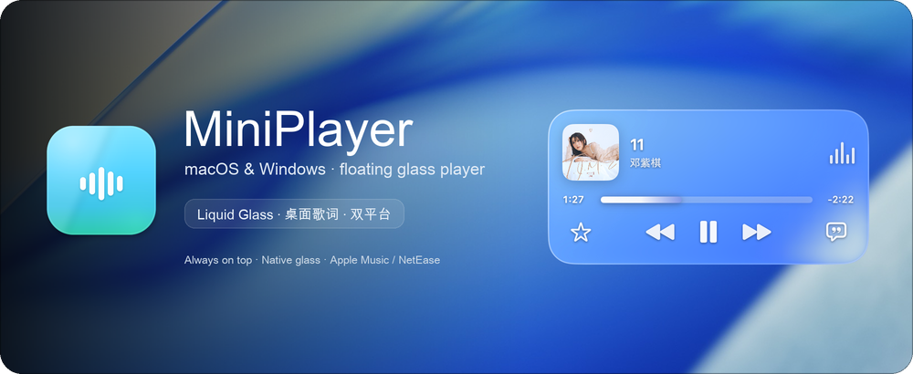
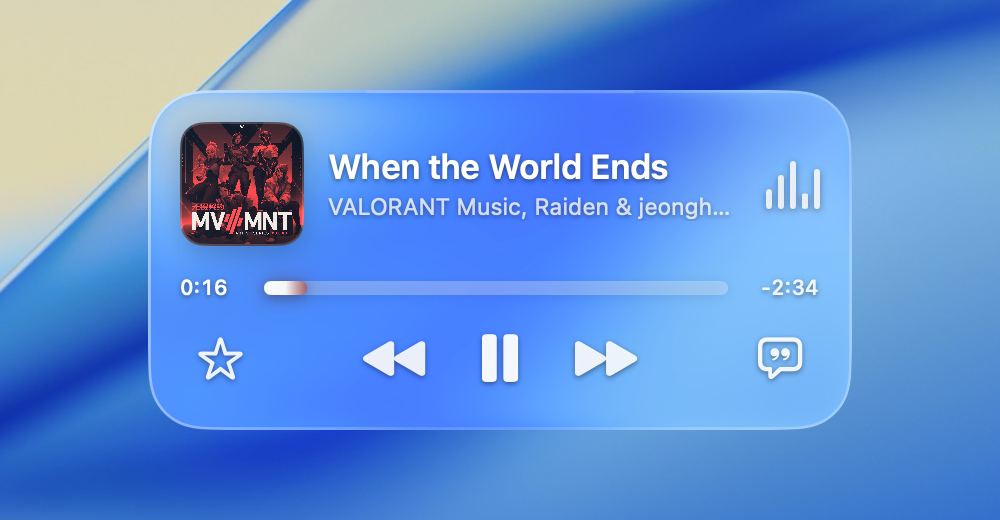
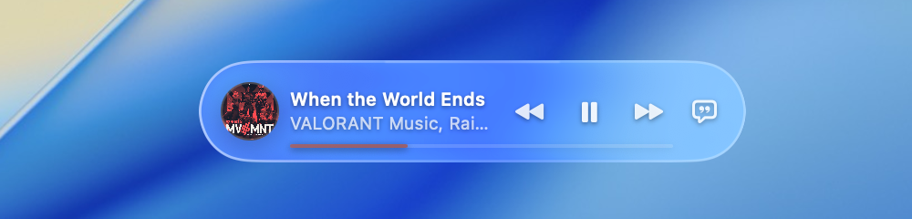

<div align="center">



# MiniPlayer

**macOS 与 Windows 的悬浮播放器：macOS 支持 Apple Music / 网易云音乐，Windows 先支持网易云音乐。**

[English](README.en.md) | 简体中文

<p>
  <a href="https://github.com/Kensh1n-Ch3n/MiniPlayer/releases/latest"></a>
  
  
  
  
  <a href="LICENSE"></a>
  <a href="https://github.com/Kensh1n-Ch3n/MiniPlayer"></a>
  <a href="#-支持作者"></a>
</p>

<p>
  <a href="#-macos-功能">macOS 功能</a> ·
  <a href="#-macos-界面">macOS 界面</a> ·
  <a href="#-macos-安装">macOS 安装</a> ·
  <a href="#-windows-版">Windows 版</a> ·
  <a href="#-macos-使用">macOS 使用</a> ·
  <a href="#-歌词与对齐">歌词与对齐</a> ·
  <a href="#-资源占用与缓存">资源占用与缓存</a> ·
  <a href="#-常见问题">FAQ</a> ·
  <a href="#-license">License</a> ·
  <a href="#-支持作者">支持作者</a>
</p>

</div>

---

## ✨ macOS 功能

- **双播放器来源**：支持 Apple Music 和网易云音乐。通过系统 Now Playing 自动识别当前播放器，切歌、暂停/播放、歌词和封面显示都会同步。
- **原生 Liquid Glass**：macOS 26+ 使用 SwiftUI 原生 `.glassEffect(.clear, in:)`，由系统完成折射、模糊和边缘高光；macOS 14–15 回退到自定义虚化。
- **迷你长条模式**：双击卡片空白处可在完整播放器和 300×56 胶囊长条之间切换；长条保留封面、歌曲名、上一首 / 播放 / 下一首、歌词按钮和一条细进度线；点击封面会打开当前播放器，悬停时封面会高亮并显示打开箭头。
- **完整播放控制**：收藏、上一首、播放 / 暂停、下一首；进度条支持点击和拖动跳转。
- **轻量切换动效**：播放/暂停、上一首/下一首带有方向感切换动画，操作响应清晰。
- **封面交互**：点击专辑封面打开当前播放器；Apple Music 下会隐藏卡片，网易云音乐下卡片保留。悬停封面会显示打开提示。
- **单行桌面歌词**：只显示当前一句，不显示上下句；窗口宽度随歌词长度变化，方便左右拖动；点击卡片右下角的歌词按钮即可开关。
- **菜单栏歌词**：播放时菜单栏显示当前歌词，暂停或未播放时显示图标；长句平滑滚动，滚完整句后停止，不循环。
- **直接拖动歌词**：按住桌面歌词文字即可移动，松手自动保存，不需要额外操作按钮。
- **歌词匹配**：Apple Music 使用 Apple Music 官方时间轴；网易云音乐使用网易云歌词接口；对应来源没有歌词时自动回退到 LRCLIB 等来源。
- **原文优先**：繁体中文自动转简体；英文、韩文、日文保留原文。
- **屏幕内约束**：播放器卡片和桌面歌词都限制在屏幕可见区域内。
- **低占用**：常驻内存约 **40 MB**，播放和歌词滚动保持轻量。

## 📸 macOS 界面

<p align="center">
  <b>Liquid Glass 完整播放器</b><br><br>
  
</p>

<p align="center">
  <b>单行桌面歌词</b><br><br>
  
</p>

<p align="center">
  <b>菜单栏歌词</b><br><br>
  
</p>

<p align="center">
  <b>迷你长条模式</b><br><br>
  
</p>

> 原生玻璃会实时采样组件背后的窗口内容。背后是照片或壁纸时会显示被虚化的颜色；背后是白色窗口时偏白，这是系统玻璃的真实行为。

## 🚀 macOS 安装

### 直接使用

1. 下载并解压 [MiniPlayer.zip](https://github.com/Kensh1n-Ch3n/MiniPlayer/releases/latest/download/MiniPlayer.zip)。
2. 把 `MiniPlayer.app` 拖进「应用程序」文件夹。
3. 双击打开。

首次启动时系统会弹出：

> 首次使用 Apple Music 时，系统会请求控制「音乐.app」

请点 **允许**。如果误点「不允许」，可以在菜单栏音乐小窗里打开 **自动化权限设置…**，或手动前往：

`系统设置 → 隐私与安全性 → 自动化 → 音乐小窗 → 音乐`（仅 Apple Music 需要）

### 系统要求

- macOS 14 或更新版本
- Apple Music 和/或 网易云音乐
- 原生 Liquid Glass 需要 macOS 26+；旧系统会自动使用回退玻璃效果

## 🎮 macOS 使用

| 操作 | 方式 |
| --- | --- |
| 移动播放器 | 按住卡片顶部空白区域拖动 |
| 打开当前播放器 | 点击专辑封面；Apple Music 下小组件会隐藏，网易云音乐下保持显示 |
| 显示 / 隐藏播放器 | 菜单栏音符图标，`⌘⇧M` |
| 收起为迷你模式 | 双击卡片空白处，或菜单栏 → 收起为迷你模式 |
| 展开完整播放器 | 双击卡片空白处，或菜单栏 → 展开完整播放器 |
| 显示 / 隐藏桌面歌词 | 卡片右下角歌词按钮，`⌘⇧L` |
| 显示 / 隐藏菜单栏歌词 | 菜单栏菜单 → 在菜单栏显示歌词 |
| 调整菜单栏歌词位置 | 按住 `⌘` 拖动菜单栏歌词项 |
| 移动桌面歌词 | 直接按住歌词文字拖动 |
| 调整歌词时间 | 菜单栏 → 歌词设置 → 提前 / 延迟 0.2 秒 |
| 调整歌词字号 / 位置 | 菜单栏 → 歌词设置 |
| 请作者喝咖啡 | 菜单栏 → 请作者喝杯咖啡… |
| 退出 | 菜单栏 → 退出音乐小窗，`⌘Q` |

## 🎵 歌词与对齐

### 来源顺序

1. **Apple Music 官方 TTML 缓存**：Music 播放时会把官方逐行歌词缓存在本机，App 直接解析 Apple 的时间轴。这是默认的 0 偏置对齐来源。
2. **LRCLIB**：如果 Apple 没有缓存，使用 LRCLIB 的同步 LRC。
3. **网易云音乐 LRC**：LRCLIB 只有纯文本时使用。
4. **Apple Music 内嵌歌词 / 估算**：最后兜底；没有真实时间轴时不保证对齐。

歌词缓存目录：`~/Library/Caches/MiniPlayer/lyrics`

### 关于偏移

- 使用真实时间轴的歌，**偏置 0 即对齐**。
- 如果某个版本的音乐/歌词本身有时间差，可以在菜单栏微调 ±0.2 秒。
- 英文、韩文、日文保留原文，不再用中文译文覆盖。

## ⚡ 资源占用与缓存

- 常驻内存约 **40 MB**，只保留当前歌曲的封面和歌词。
- 封面缓存：`~/Library/Caches/MiniPlayer/artwork`，上限约 **160 MB**。
- 歌词缓存：`~/Library/Caches/MiniPlayer/lyrics`，上限约 **32 MB**。
- 启动时自动清理 **30 天**前的缓存；超过大小上限时从最旧文件开始清理。

## 🛠️ macOS 从源码构建

要求 Xcode 15+、Swift 5.9+。

```bash
cd macos
./scripts/build.sh
```

构建产物：

- `dist/MiniPlayer.app`
- `dist/MiniPlayer.zip`

App 会优先使用本机可用的 Apple Development 证书签名；没有证书时回退 ad-hoc 签名。项目依赖系统框架，无第三方运行时依赖。

## 🪟 Windows 版

Windows 工程位于 `windows/`，当前**先只支持网易云音乐**。

- 通过 Windows SMTC 读取网易云的歌曲、歌手、封面、进度和播放状态；
- 播放 / 暂停、上一首、下一首、进度跳转；
- 完整 / 迷你悬浮卡片、桌面单行歌词、系统托盘；
- 使用 DWM Acrylic + 圆角 + 半透明渐变和内层高光模拟玻璃质感。参考了 [pratikone/liquid-glass-WinUI](https://github.com/pratikone/liquid-glass-WinUI) 的玻璃分层思路；完整 Win2D 折射需要 WinUI 3 host，当前 Avalonia 版是近似实现。

在 `windows/` 下构建：

```bash
dotnet build -c Release
dotnet publish -c Release -r win-x64 --self-contained true -o publish/win-x64
```

当前 Windows 版是实验性移植，尚未在 Windows 机器上运行验证；使用网易云客户端时需确保它向 Windows 暴露 SMTC 媒体会话。

Windows 安装包：[MiniPlayerWin-win-x64.zip](https://github.com/Kensh1n-Ch3n/MiniPlayer/releases/latest/download/MiniPlayerWin-win-x64.zip)

## ❓ 常见问题

<details>
<summary><b>为什么点击专辑封面后小组件消失了？</b></summary>

这是设计行为：Apple Music 主窗口和小组件在屏幕上互斥。关闭 Music 窗口、最小化或退出 Music 后，小组件会自动回来。
</details>

<details>
<summary><b>为什么歌词有时候是估算的？</b></summary>

Apple Music 的脚本接口不暴露逐行时间轴；如果本机没有官方 TTML 缓存、LRCLIB 和网易云也没有同步 LRC，就只能按纯文本估算，此时无法保证 0 偏置完美对齐。
</details>

<details>
<summary><b>为什么没有上架 App Store？</b></summary>

本项目是本地自用工具，没有做公证和沙盒适配。正式分发需要额外的签名与审核配置。
</details>

## ☕ 支持作者

如果音乐小窗对你有帮助，欢迎请我喝杯茶。你的支持会让它继续更新。

<p align="center">
  
</p>

<p align="center">
  <b>打开支付宝扫一扫</b><br>
  <sub>Buy Me a Coffee · 饮茶先啦 (*晨)</sub>
</p>

## 🙏 致谢

- [Apple SwiftUI `Glass` 文档](https://developer.apple.com/documentation/SwiftUI/Glass) 与 [awesome-liquid-glass](https://github.com/GetStream/awesome-liquid-glass)：原生 Liquid Glass 的参考示例
- [LRCLIB](https://lrclib.net)：开放同步歌词数据

## 📄 License

本项目使用 **MIT License**，完整协议见根目录的 [LICENSE](LICENSE) 文件。

---

<div align="center">
  <sub>Made for macOS · Apple Music & NetEase Cloud Music · Released under the MIT License</sub>
</div>
